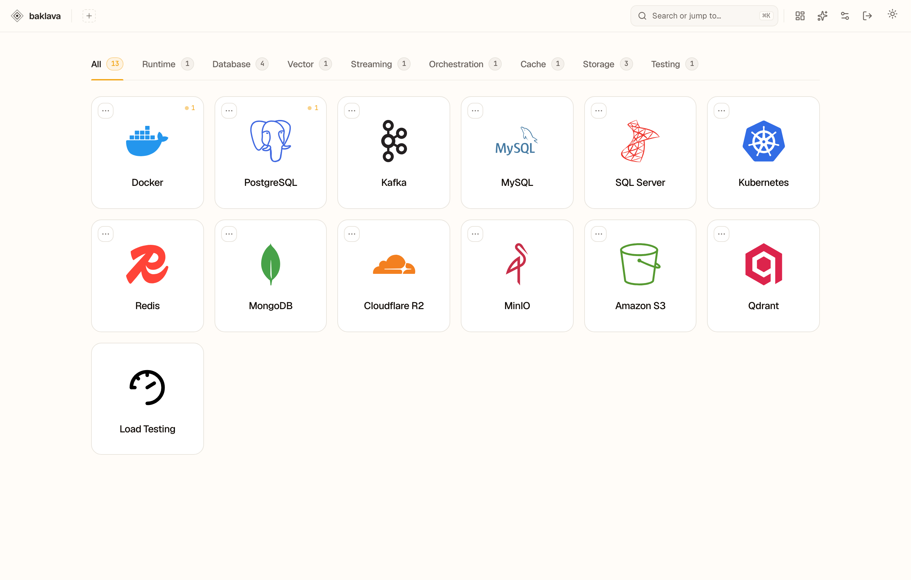
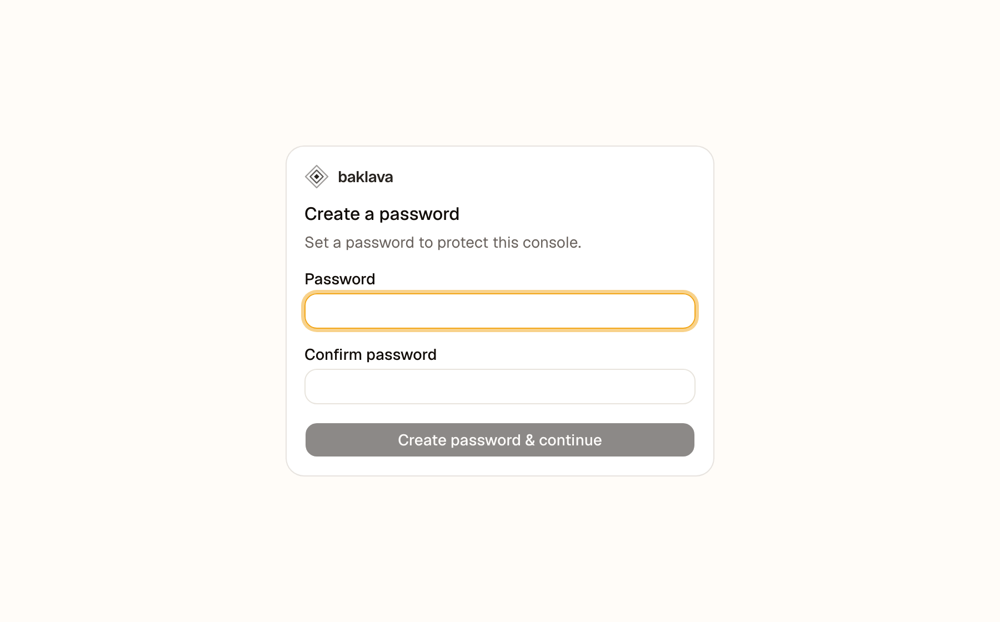
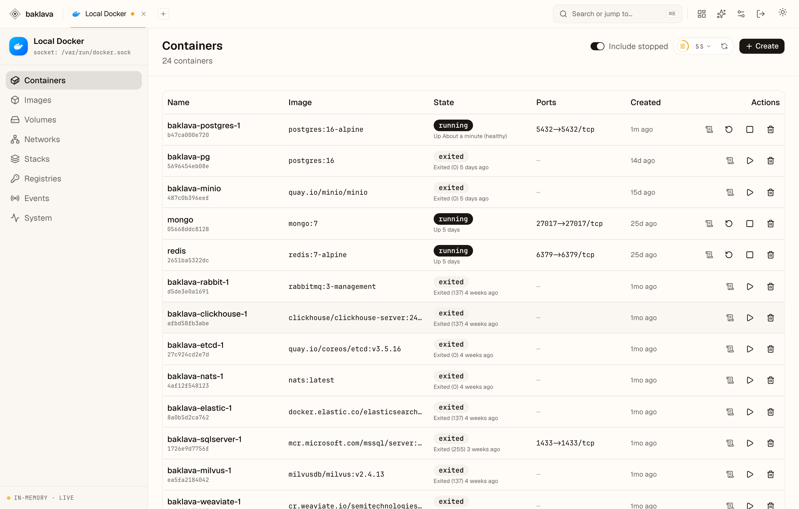
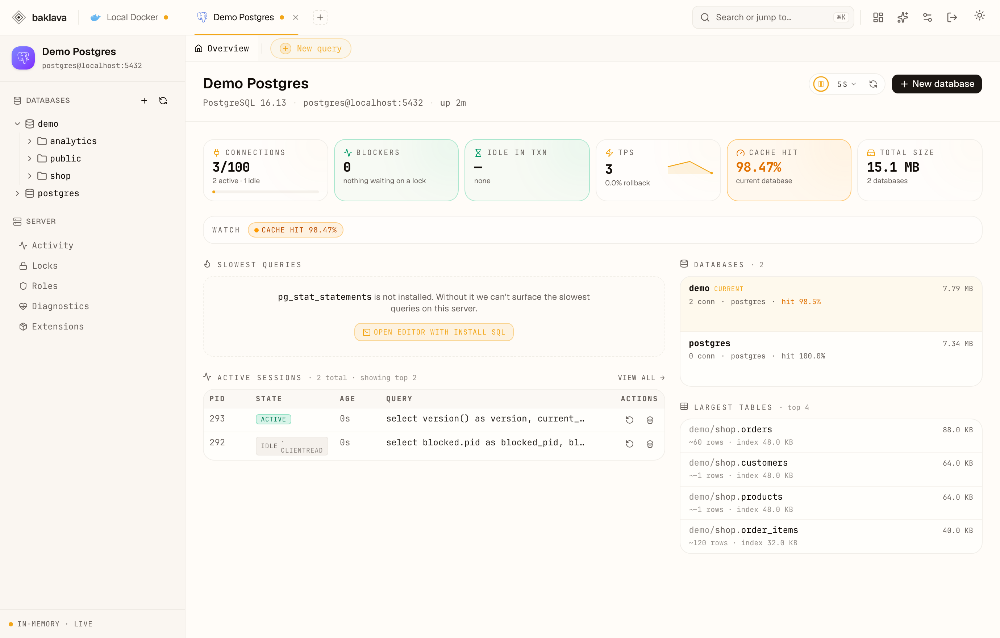
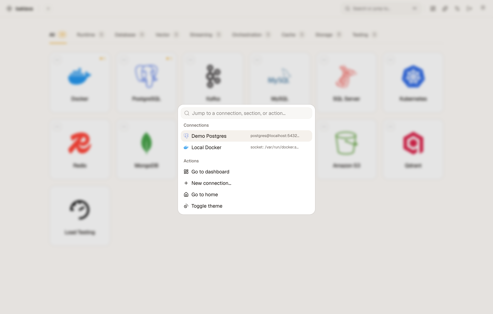

# Baklava

**One console for your whole backend.**

Baklava is a free, open-source dashboard for the infrastructure you already run — Docker, databases, Kafka, Kubernetes, Redis, object storage, and more. Each one gets a workspace modeled on the dedicated app you'd normally reach for, so you stop juggling Docker Desktop, pgAdmin, kafka-ui, RedisInsight, an S3 browser, and a dozen browser tabs. It all lives in one place, on your machine.



---

## Get started in two minutes

You need [Node.js](https://nodejs.org) 20+ and (optionally) [Docker](https://www.docker.com/products/docker-desktop/).

```bash
npm install
npm run dev
```

Open **http://localhost:3000**.

The first time you open Baklava, it asks you to **create the admin account**: enter the one-time setup token printed in the terminal, then pick a password of at least 12 characters. There's no default — it's stored (hashed) only on your machine.



That's it. Docker works immediately. For everything else, you add a connection in the UI.

### Or run it in Docker

The image is published as [`erenmeren/baklava`](https://hub.docker.com/r/erenmeren/baklava) (`linux/amd64`; tags `latest` and the version, e.g. `0.1.0`). To build it yourself instead: `docker build -t erenmeren/baklava .`

A container on Docker's default network can't see your machine: `localhost` is the container itself, and the Docker socket and your kubeconfig aren't in its filesystem. On Linux, give it the host's network and the same files, and it behaves like `npm start`:

```bash
mkdir -p ~/.baklava
docker run -d --name baklava --network host \
  --user "$(id -u):$(id -g)" --group-add "$(stat -c %g /var/run/docker.sock)" \
  -e HOME="$HOME" \
  -v "$HOME/.baklava:$HOME/.baklava" \
  -v "$HOME/.kube:$HOME/.kube:ro" \
  -v /var/run/docker.sock:/var/run/docker.sock \
  -v /tmp:/tmp \
  erenmeren/baklava
docker logs baklava   # first run: prints the setup token
```

- `--network host`: `localhost:5432`, a kubeconfig's `127.0.0.1:6443` and so on are the host's. The console listens on `127.0.0.1:3000` only (`-e PORT=…` to move it).
- Files are mounted at the same path as on the host, so `~/.kube/config` and any saved kubeconfig path keep working. Add a `-v` for a kubeconfig kept elsewhere; drop the `.kube` line if you have none.
- The socket mount makes whoever can sign in root on the host — keep the sign-in on.
- `/tmp` is only for load tests: k6 runs through the host's Docker daemon and reads its script from there.
- Every driver is preinstalled; installing or removing drivers from the UI is switched off in the image.
- A kubeconfig that signs in through an `exec` plugin (`aws`, `gcloud`, …) needs that binary; the image doesn't carry it.

On Docker Desktop (macOS / Windows) host networking doesn't reach the machine's own services. Publish the port instead and use `host.docker.internal` as the host in your connections:

```bash
docker run -d --name baklava -p 127.0.0.1:3000:3000 \
  -v baklava-data:/home/node/.baklava erenmeren/baklava -H 0.0.0.0
```

---

## How to use it

**1. Pick a technology** from the home grid and add a connection. You fill in the host, port, and credentials, then hit **Test** — a successful test saves it. (Docker needs nothing; it uses your local Docker automatically.)

**2. Open the connection** to land in a full workspace — sidebar, tables, detail views — shaped like the tool you already know.

For example, the **Docker** workspace is a Portainer-grade view of your containers, images, volumes, networks, and stacks, with logs, stats, and a real terminal one click away:



And the **PostgreSQL** workspace feels like pgAdmin — a live health dashboard, a schema tree, table browsers, and a SQL editor with autocomplete:



**3. Jump anywhere with ⌘K.** Press **⌘K / Ctrl+K** (or the search pill in the header) to hop to any connection, section, or object, or to run quick actions like adding a connection.



---

## What's integrated

| Category | Technologies | Modeled on |
|---|---|---|
| **Runtime** | Docker | Docker Desktop / Portainer |
| **Database** | PostgreSQL · MySQL · SQL Server · MongoDB | pgAdmin · phpMyAdmin · SSMS · Compass |
| **Streaming** | Kafka | kafka-ui |
| **Orchestration** | Kubernetes | k9s |
| **Cache** | Redis | RedisInsight |
| **Vector** | Qdrant | — |
| **Object storage** | Cloudflare R2 · MinIO · Amazon S3 | an S3 file browser |

Each workspace gives you the everyday operations you'd expect: browse and edit data, run queries, watch logs and metrics, manage objects, and perform the destructive actions (drop, delete, prune) behind clear confirmations.

---

## Your data stays on your machine

Baklava has no cloud, no account, and no telemetry. Connections are saved to `~/.baklava/connections.json` (readable only by you) so they survive restarts. Set `BAKLAVA_DATA_DIR` to store them somewhere else.

### Credentials on disk

Connection, AI-provider and load-test secrets in `~/.baklava/*.json` are stored as **plain JSON**, in files only your OS user can read (`0600`, directory `0700`). Anyone who can read that directory — a backup, another process running as you — can read the credentials, so keep it on an encrypted disk and treat its backups as secrets.

Files written by an older version that encrypted them can't be read any more: Baklava refuses them instead of starting empty, and keeps one as `<file>.unreadable.bak` before overwriting it.

### The password gate

Because Baklava can read every stored credential and run destructive queries, it sits behind a sign-in whenever it's reachable over a network.

- **It listens on `127.0.0.1` by default.** To serve it to your network, start it with `BAKLAVA_HOST=0.0.0.0 npm start` (or `npm run dev -- -H 0.0.0.0`) — and put TLS in front of it.
- **You create the first admin on first run** — there is no default to forget or leak. The sign-in page asks for a one-time **setup token**, printed in the terminal running Baklava, so nobody else on the network can claim the console before you do (`BAKLAVA_SETUP_TOKEN` pre-sets it for scripted installs).
- **Passwords need at least 12 characters.**
- **Change it** anytime in **Settings → Security**, and use **Lock console** in the header to sign out.
- **Turn the gate off** in **Settings → Security** if you're on a trusted machine and the prompt is just friction. Leave it **on** for anything exposed to a network.
- Prefer to set it up front? Start with `BAKLAVA_INITIAL_PASSWORD='your-password' npm run dev` to skip the setup screen (it becomes the `admin` user's password).

The password is hashed (scrypt) and stored in `~/.baklava/auth.json`. It never leaves the server.

### Users & roles

Baklava supports **multiple users**. Each user has a username, a password, and a **role**:

- **admin** — full control: manages users, sees and edits every connection, and changes console-wide settings.
- **member** — can only use the connections an admin has granted them, and never sees the **Users** tab.

**Per-connection access.** A connection's owner and any admin always have full (write) access. For everyone else an admin grants **read** or **write** per connection — members only see connections they've been granted, and can't reach others even by guessing the URL.

**Logging in.** You sign in with a **username and password**. As a convenience, while there's only **one** user the login page accepts the password alone (no username needed).

**Upgrading from a single-password install.** The first time a console with an existing password starts on this version, it **auto-migrates** to an admin user named **`admin`** that reuses your existing password — so your current password keeps working, you just sign in as `admin`. (All devices are signed out once during the migration; just sign in again.) Add and manage more users under **Settings → Users** (admins only).

User records live in `~/.baklava/users.json` and access grants in `~/.baklava/connection-access.json`, both `0600` like the rest of `~/.baklava`. Passwords are scrypt-hashed and never leave the server.

### AI assistant safety controls

The `/assistant` page lets you run a natural-language agent over your connections. A few safeguards keep it from going rogue:

- **Per-session budget** — each session is capped at 300 tool calls total; only runaway multi-step loops ever reach it.
- **Rate limit** — 40 tool calls per 10 seconds per session/connection pair; normal chat is well under this.
- **Destructive circuit breaker** — if 8 destructive actions fire within 60 seconds the session pauses; reads are never blocked.
- **Global kill switch** — the **Pause AI** toggle in the assistant header writes to `~/.baklava/ai-controls.json` and survives process restart. When paused, all non-read AI actions are blocked across every session; reads still go through.
- **Stop button** — aborts the current in-flight run immediately.
- **Destructive actions always require explicit approval** — this cannot be turned off, even in autonomous mode. Every approval prompt shows a **risk level** (low / medium / high) and the reasons behind it (e.g. "no WHERE clause", "wildcard match"). High-risk destructive actions go one step further: the Approve button stays disabled until you type the connection name to confirm, and the server re-checks that name. An approval can only be answered by the user who started the turn, and is declined automatically when the request ends or after 15 minutes. The risk assessment comes from `src/lib/ai/risk.ts`; the gate itself lives in `src/lib/ai/permissions.ts`.
- **Plan mode** — an opt-in toggle you can flip per conversation. When it's on, the assistant proposes an ordered plan of the steps it intends to take and waits for your approval before acting. It augments the safety gates above rather than replacing them: destructive steps still require their own per-action approval when they run.

### Egress safety (SSRF protection)

The server blocks outbound connections to cloud-metadata endpoints (e.g. `169.254.169.254`, `fd00:ec2::254`, Alibaba's `100.100.100.200`, Oracle's `192.0.0.192`, and their NAT64 / 6to4 spellings) and link-local addresses when those addresses come from user-supplied input — connection targets (checked when a connection is tested, saved or edited), the load-test target URL and the health reachability probe. Load tests also hand k6 the blocked ranges as `blacklistIPs`, so a redirect can't lead there either. The host is resolved first and the resulting IP is pinned for the actual connection, so DNS rebinding attacks can't slip a blocked address past the check after the initial lookup. Private and loopback addresses (your machine, your LAN) are intentionally **not** blocked, so you can test and monitor local services as normal. If you genuinely need to reach a specific blocked address (e.g. from inside a container network), set `BAKLAVA_EGRESS_ALLOW=<ip,ip>` to re-allow those exact IPs.

### Sessions

Signing in creates a **server-side session** stored in `~/.baklava/sessions.json`. You can view and revoke your own devices under **Settings → Active sessions**, or sign out all your other devices at once.

Failed sign-ins are throttled per account (10 per 15 minutes).

### Running behind a reverse proxy

State-changing requests from another origin — including another port on the same host — are refused, as are API calls a browser labels cross-site or same-site. When Baklava sits behind a reverse proxy that serves it on a different host name:

- `BAKLAVA_TRUST_PROXY=1` trusts `X-Forwarded-Host` (for the origin check) and `X-Forwarded-For` (adds a per-client login throttle). Only set it when the proxy overwrites those headers.
- `BAKLAVA_ALLOWED_ORIGINS=https://ops.example.com,…` lists extra origins allowed to make requests.

Every request's `Host` must be `localhost`, an IP literal, the trusted proxy's `X-Forwarded-Host`, or a host listed in `BAKLAVA_ALLOWED_ORIGINS`; anything else gets **421** (this blocks DNS-rebinding attacks). If you open Baklava by a DNS name (e.g. `http://ops.internal:3000`) without a trusted proxy, add it to `BAKLAVA_ALLOWED_ORIGINS`. Under `BAKLAVA_TRUST_PROXY=1`, make sure the proxy forwards only its own server name as `X-Forwarded-Host`.

Responses carry `frame-ancestors 'none'`, `X-Frame-Options: DENY`, `nosniff` and `Referrer-Policy: same-origin`. Terminate TLS and set HSTS at the proxy.
If the proxy terminates TLS but doesn't send `X-Forwarded-Proto`, set `BAKLAVA_SECURE_COOKIES=1` so the session cookie is still marked `Secure`.

### Hardening checklist

For anything beyond your own laptop:

- **Keep the sign-in on**, and serve Baklava only over TLS (reverse proxy + HSTS). It binds `127.0.0.1` unless you tell it otherwise.
- **Keep `~/.baklava` on an encrypted disk** — it holds credentials in plain JSON — and guard its backups the same way.
- **Give each connection a least-privilege database user.** The assistant's read-only SQL tools screen out statements that write, but the database role is the real boundary: no superuser / `pg_execute_server_program` on Postgres, no `FILE` / `SUPER` on MySQL, no `sysadmin` on SQL Server for connections the assistant or read-only members use.
- **Grant members only the connections they need**, and `read` unless they must change things. Only admins can use the host's Docker socket or kubeconfig files.
- Leave the **AI kill switch** within reach (assistant header) and review a connection's assistant policy before switching it to autonomous.

- Sessions expire after **7 days idle** (sliding) or **30 days absolute**, whichever comes first.
- Signing out revokes the session server-side — deleting the cookie is not enough for a remote attacker to reuse it.
- **Changing the password invalidates every session** — all devices are signed out immediately.
- **Upgrading from an older version** signs everyone out once (the session token format changed); just sign in again.

---

## Want demo data to explore?

A `compose.yaml` at the project root spins up Postgres, Kafka, and SQL Server so you have something real to click through:

```bash
docker compose up -d           # start everything
bash seed/all.sh               # fill it with demo data
docker compose down -v         # stop and wipe when you're done
```

This gives you a 250-row storefront in Postgres, a keyed Kafka stream, and a labelled Docker stack. Then add these connections in the UI (all local, throwaway):

| Tech | Host | Port | User | Password | Notes |
|---|---|---:|---|---|---|
| **Docker** | — | — | — | — | detected automatically |
| **PostgreSQL** | localhost | 5432 | `postgres` | `Baklava123!` | database `demo` |
| **Kafka** | — | — | — | — | broker `localhost:9092` |
| **SQL Server** | localhost | 1433 | `sa` | `Baklava123!` | encrypt on, trust server cert |

See [`seed/README.md`](seed/README.md) for exactly what each script creates.

Pointing at a service you already run? Any standard connection works — for example:

```bash
docker run -p 6379:6379 redis:latest          # Redis
docker run -p 27017:27017 mongo:latest        # MongoDB
docker run -p 6333:6333 qdrant/qdrant         # Qdrant
```

For Kubernetes, Baklava reads your existing `~/.kube/config` — no setup needed.

---

## Contributing

Baklava is built with Next.js 16, React 19, and TypeScript. Want to run it from source, understand the architecture, or add a new technology? See **[CONTRIBUTING.md](CONTRIBUTING.md)**.

## License

Open source — license to be added.
